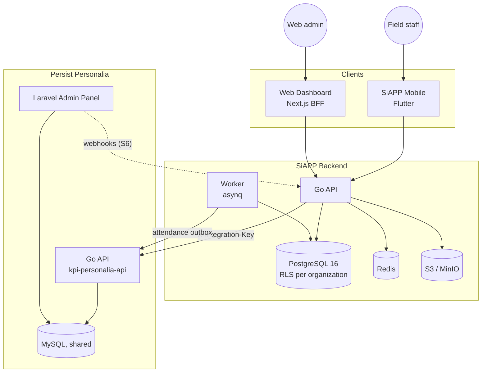

# Backend Architecture

**Directory**: `/siapp` (first build) → rebuild per `syap/docs/plan`

## System Context



## Login Flow

SiAPP never sees a Personalia token. The only secret shared between the two systems is the integration key.

```
SiAPP app ──(email, password, device_token)──▶ SiAPP POST /api/v1/auth/login
                                                    │  X-Integration-Key
                                                    ▼
                         Personalia POST /api/v3/integrations/siapp/login
                           checks password + active employee, binds device,
                           issues NO Personalia token
                                                    │
                    { user_id, nik, name, company, client, active, ... }
                                                    ▼
                         SiAPP upserts organization + person (no password),
                         issues its own access (15 min) + refresh tokens
```

*   **One phone per person.** Personalia's device table is the record. HR resets a lost phone in the Personalia admin panel; SiAPP notices within 12 h and ends the old phone's sessions.
*   **Web logins** bind no device and are allowed only for people with a web role (`ORG_ADMIN` / `PROJECT_ADMIN`).
*   **Organization = employing company** (`m_employee_work.company_id`). The placement client is stored on the person, not used as the tenant.

## Code Layout

| Path | Content |
| :--- | :--- |
| `cmd/api` | HTTP server (wiring only) |
| `cmd/worker` | asynq worker + periodic scheduler |
| `cmd/migrate` | goose runner, runs as the owner role |
| `cmd/seed` | dev seed, `grant-admin` bootstrap |
| `cmd/personel-stub` | fake Personalia for local dev and tests |
| `pkg/platform/*` | cross-cutting helpers: `config`, `database` (`WithTenant`), `httpx`, `apperr`, `idem`, `audit`, `personel`, `testkit` |
| `pkg/<domain>/` | `handler.go` → `usecase.go` → `repo.go`, plus `item.go`, `errors.go`, `constants.go` |
| `db/migrations`, `db/queries` | goose SQL, sqlc queries (one file per domain) |
| `internal/db`, `internal/apigen` | generated code only (sqlc, oapi-codegen) |

## API Areas (`/api/v1`, from the PERSIST contract)

| Area | Prefix | Key Endpoints |
| :--- | :--- | :--- |
| Auth | `/auth` | `login`, `refresh`, `logout`, `me` |
| Notifications | `/notifications` | inbox, `token` (push registration) |
| Organization | `/organization`, `/teams`, `/shift-swaps` | projects, teams, members, shifts, swaps |
| Access | `/permissions` | permission matrix, scopes |
| Attendance | `/attendances` | selfie/QR check-in/out, history, leave, absence |
| Presence | `/personnel-tracking` | online status, live location |
| Panic | `/panics` | trigger, resolve, history |
| Patrol | `/zones`, `/scans`, `/patrol`, `/qr-codes` | zones, QR scans, progress |
| Reports | `/reports`, `/report-categories` | offline-capable reports |
| Instructions | `/instructions` | targeting, inbox/sent, feedback |
| CCTV | `/cctvs` | camera list, short-lived playback |
| Analytics | `/report-summary`, `/overview` | 13 report types, exports, dashboard |
| Assets | `/assets`, `/asset-reports`, `/asset-conditions` | inventory and field reports |
| Cleaning | `/e-memos`, `/qr-codes` | E-Memo, Generate QR |
| Admin | `/admin/**` | web roles, master data, admin views (gated by `RequireAdmin`) |

Paths owned by Personalia (`/admin/personnels`, `/admin/clients`, `/auth/forgot-password`, `/platform/**`, `/billing/**`, …) are **not** implemented here (decision D5).

## Data (PostgreSQL)

| Rule | How |
| :--- | :--- |
| **Tenant column** | Every tenant table has `organization_id`, defaulting to the transaction's `app.current_org` setting |
| **Isolation** | RLS `ENABLE` + `FORCE` + policy `org_isolation`; the app role `siapp_app` cannot bypass it; a test fails if a table misses it |
| **Single data path** | `database.WithTenant(ctx, orgID, fn)`: a transaction with the tenant set; the org comes from the token, never the request |
| **People** | `personnels`: a cache of Personalia people keyed by NIK, **no credentials** |
| **Offline replay** | `Idempotency-Key` header + `local_id` column |
| **Audit** | `audit_logs`, append-only (no `UPDATE`/`DELETE` grant), partitioned by month |

## External Integrations

| Service | Config Key | Purpose |
| :--- | :--- | :--- |
| Persist Personalia | `PERSONEL_BASE_URL`, `PERSONEL_INTEGRATION_KEY` | Login, people by NIK, org read, attendance push, leave |
| Personalia webhooks | `PERSONEL_WEBHOOK_SECRET` | Employee/placement changes (signature-checked) |
| PostgreSQL | `DATABASE_URL`, `MIGRATE_DSN` | App role / owner role |
| Redis | `REDIS_URL` | Rate limits, revocation list, cache, jobs, pub/sub |
| S3 / MinIO | `S3_*` | Photos and evidence, presigned URLs |
| Firebase | `FCM_SERVICE_ACCOUNT_BASE64` | Push notifications |
| MediaMTX | (module 13) | CCTV stream gateway |
| SiAPP tokens | `JWT_SECRET` | HS256 access tokens |
